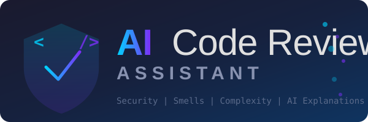
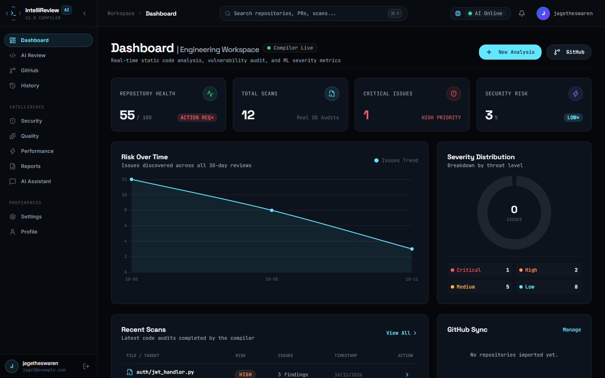
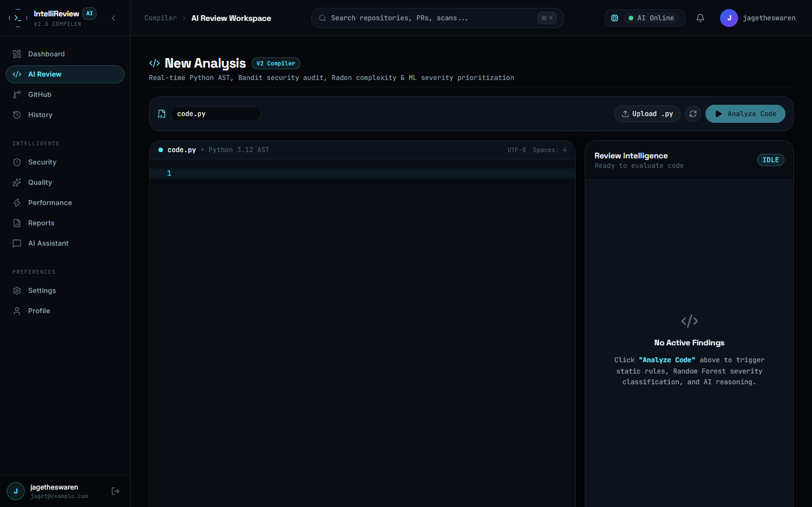
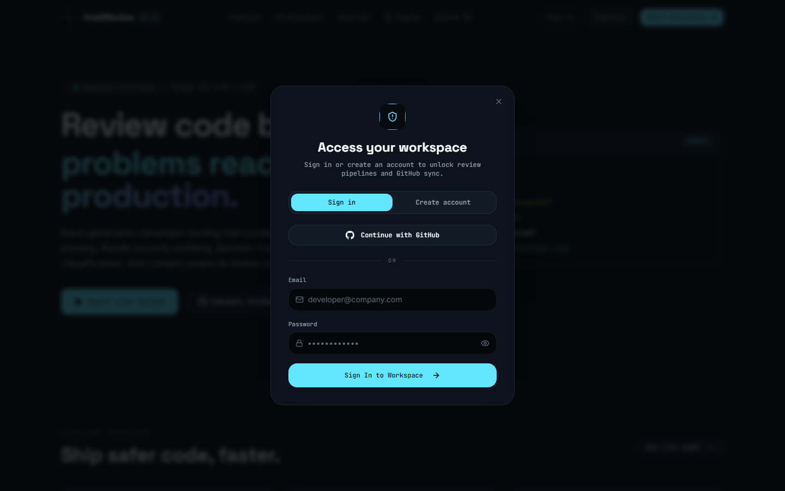
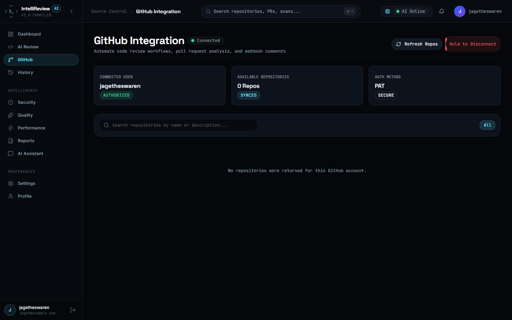

<div align="center">



# IntelliReview AI V2

**AI-Powered Intelligent Code Review & Secure Pull Request Analysis Platform**

[](https://github.com/jagetheswaren/AI-Code-Review-Assistant/actions/workflows/ci.yml)
[](LICENSE)
[](https://python.org)
[](https://reactjs.org)
[](https://mongodb.com)
[](https://scikit-learn.org)
[](https://groq.com)

A modern full-stack developer intelligence platform combining **Static Code Analysis**, **Machine Learning Severity Classification**, and **Multi-Provider Generative AI** (Groq with Ollama fallback) to audit Python source code and automate GitHub pull request reviews.

</div>

---

## 📸 Real Application Tour

### 1. Unified Security & Quality Dashboard
Real-time vulnerability metrics, risk-over-time trends, health scores, and synchronization with your GitHub repositories.



### 2. AI Code Review Workspace
Monaco code editor with Python syntax highlighting, instant AST scanning, ML severity grading, and one-click remediation patch application.



### 3. Deep Security Posture Center
Detailed breakdown of CWE classifications, dangerous sink analysis (eval, command injection, weak cryptography, plaintext protocols), and exact code coordinates.



### 4. GitHub Integration & Repository Browser
Connect via Personal Access Token or OAuth to inspect repositories, branches, open PRs, and automatically post line-by-line review comments.



### 5. Audit History Ledger & Multi-Format Reports
Complete audit trail for all scanned files and pull requests with compliance export into PDF, CSV, and JSON formats.


---

## 🌟 Core Features & Modules

- **Instant Code Scanning**: Unauthenticated guest code scanning on `/review` with an account claim workflow (`/api/scan/<id>/claim`) to link scans upon registration.
- **Static Analysis Engine**:
  - **Bandit AST**: Detects shell injections, unsafe deserialization (pickle, yaml), dangerous dynamic execution (`eval`, `exec`), and hardcoded secrets.
  - **Custom Security Rules**: Identifies insecure temporary files (`tempfile.mktemp` / CWE-377), weak hashes (`hashlib.md5`, `hashlib.sha1` / CWE-328), and plaintext protocols (`telnetlib`, `ftplib`).
  - **Smell & Quality (Pylint / Astroid)**: Unused imports, missing docstrings, bad naming conventions, low comment density.
  - **Complexity Diagnostics (Radon)**: Cyclomatic Complexity (CC) grading, Maintainability Index (MI), and Halstead metrics.
- **Finding Aggregator & Unification**: Intelligently groups findings on identical lines and preserves evidence across all analysis sources (`ast`, `radon`, `pylint`, `ml`, `ai`).
- **Machine Learning Severity Classifier (v3)**:
  - Scikit-learn Random Forest model trained on leakage-free v2 feature vectors (`has_fix_suggestion`, normalized metrics).
  - Predicts confidence scores and calibrated severity labels (`critical`, `high`, `medium`, `low`, `info`).
- **Multi-Provider AI Fallback Engine**:
  - Primary: Ultra-fast **Groq API** (`openai/gpt-oss-120b` or Llama 3.3).
  - Local Fallback: **Ollama** (`qwen2.5-coder:7b`).
  - Offline Safety Net: Automated static rule-based review so scans never fail even without an active internet connection.
- **GitHub Automation**:
  - Personal Access Token (PAT) and OAuth 2.0 connection.
  - Webhook listener with HMAC-SHA256 signature verification (`X-Hub-Signature-256`) and idempotency deduplication.
  - Automated PR line-by-line comments.
- **Multi-Format Export Center**:
  - Audit Certificate PDF generation via ReportLab with formatted issue tables and executive summaries.
  - Structured CSV spreadsheet export.
  - Full telemetry JSON export.

---

## 🛠️ Technology Stack

| Layer | Technologies |
| :--- | :--- |
| **Frontend** | React 19, Tailwind CSS, Monaco Editor (`@monaco-editor/react`), Framer Motion, Chart.js, Lucide Icons, Axios |
| **Backend** | Python 3.11 / 3.14, Flask 3.1, Werkzeug ProxyFix, Pydantic v2 Settings, Gunicorn |
| **Database** | MongoDB 7+ (PyMongo, MongoMock for isolated testing) |
| **Static Analyzers** | Bandit, Radon, Pylint, Astroid, AST parser |
| **Machine Learning** | Scikit-learn (RandomForestClassifier v3), NumPy, Joblib |
| **AI Providers** | Groq SDK (Python), Ollama Client |
| **Reporting** | ReportLab 5 (PDF generation), CSV, JSON |
| **Testing** | Pytest, Pytest-Mock, Pytest-Asyncio, Jest, Playwright E2E |

---

## 📐 Project Architecture

```
                       ┌────────────────────────────────────────────────────────┐
                       │               React 19 Frontend (SPA)                  │
                       │   Dashboard • Monaco Review • GitHub • Reports • Auth  │
                       └───────────────────────────┬────────────────────────────┘
                                                   │ Axios (JWT / Bearer Token)
                                                   ▼
                       ┌────────────────────────────────────────────────────────┐
                       │               Flask 3 REST API Server                  │
                       │   Review API • GitHub API • Auth API • Export API      │
                       └──────┬────────────────────┬────────────────────┬───────┘
                              │                    │                    │
              ┌───────────────▼────────┐   ┌───────▼──────────┐   ┌─────▼──────────────┐
              │ Static Analysis Engine │   │ ML Classifier v3 │   │ AI Reviewer Engine │
              │ • Bandit (AST Security)│   │ • Random Forest  │   │ • Groq (Primary)   │
              │ • Radon (Complexity)   │   │ • Leakage-Free   │   │ • Ollama (Local)   │
              │ • Smell Analyzer       │   │   Feature Map    │   │ • Rule Fallback    │
              └───────────────┬────────┘   └───────┬──────────┘   └─────┬──────────────┘
                              │                    │                    │
                              └────────────────────┼────────────────────┘
                                                   │
                                                   ▼
                                     ┌───────────────────────────┐
                                     │ Finding Aggregator Engine │
                                     └─────────────┬─────────────┘
                                                   │
                                                   ▼
                                     ┌───────────────────────────┐
                                     │     MongoDB Database      │
                                     │ Scans • Users • Repos • PR│
                                     └───────────────────────────┘
```

---

## 💻 Windows Local Setup & Quickstart

This application is designed for local development on Windows.

### Prerequisites

1. **Python 3.11+** installed and added to your `PATH`.
2. **Node.js 18+ / 22+** and `npm`.
3. **MongoDB Community Server** (or Docker MongoDB container) running locally on port `27017`.
4. *(Optional for Cloud AI)*: Free Groq API Key from [console.groq.com](https://console.groq.com/keys).
5. *(Optional for Local AI)*: [Ollama](https://ollama.com/) with `ollama run qwen2.5-coder:7b`.

---

### Step 1: Clone and Configure Environment

```powershell
# Clone the repository
git clone https://github.com/jagetheswaren/AI-Code-Review-Assistant.git
cd AI-Code-Review-Assistant

# Configure root .env
Copy-Item .env.example .env

# Configure backend .env
Copy-Item backend\.env.example backend\.env
```

Open `backend\.env` and configure your settings:

```ini
FLASK_ENV=development
FLASK_PORT=5000
CORS_ORIGINS=http://localhost:3000,http://localhost:80

# Local MongoDB
MONGO_URI=mongodb://localhost:27017/code_review_assistant

# JWT Secret
JWT_SECRET=dev-super-secret-jwt-key-change-in-production

# Groq AI (Recommended for high speed)
GROQ_API_KEY=your_groq_api_key_here
GROQ_MODEL=openai/gpt-oss-120b

# Ollama Fallback (Optional)
OLLAMA_BASE_URL=http://127.0.0.1:11434
OLLAMA_MODEL=qwen2.5-coder:7b

# GitHub Personal Access Token
GITHUB_TOKEN=your_personal_access_token
```

---

### Step 2: Start Local MongoDB

If you have MongoDB installed as a Windows service:
```powershell
# Verify MongoDB is running on port 27017
Test-NetConnection -ComputerName 127.0.0.1 -Port 27017
```

Or using Docker:
```powershell
docker run -d -p 27017:27017 --name intellireview-mongo mongo:7
```

---

### Step 3: Setup & Launch Backend

```powershell
cd backend

# Create and activate virtual environment
python -m venv venv
.\venv\Scripts\Activate.ps1

# Install dependencies
pip install -r requirements.txt

# Start Flask server
python app.py
```

The backend starts at `http://127.0.0.1:5000`. You can verify health:
```powershell
curl http://127.0.0.1:5000/health
curl http://127.0.0.1:5000/ready
```

---

### Step 4: Setup & Launch Frontend

Open a new PowerShell terminal:

```powershell
cd frontend

# Install Node dependencies
npm install

# Start React development server
npm start
```

The frontend will open at `http://localhost:3000`.

---

## 🧪 Testing Commands & Verified Results

IntelliReview AI maintains an extensive automated test suite covering unit, integration, and browser end-to-end flows.

### 1. Backend Pytest Suite
```powershell
cd backend
.\venv\Scripts\python.exe -m pytest tests/ -v
```
**Verified Results:**
- **102 passed, 1 skipped** (103 total) in 60s.
- Validates static analyzers, AST rules, ML v3 pipeline, Groq AI connectivity, JWT auth, guest scan claiming, and GitHub webhook HMAC verification.

### 2. Frontend Jest Suite
```powershell
cd frontend
npm run test:ci
```
**Verified Results:**
- **5 passed, 5 total** in 35s.

### 3. Playwright Browser E2E Suite
```powershell
cd frontend
npx playwright test
```
**Verified Results:**
- **11 passed across 3 viewports** (Mobile 360x800, Tablet 768x1024, Desktop 1440x900) in 31.5s.
- Tests navigation, authentication validation, instant review submission, and scan history.

---

## 📁 Repository Structure

```
AI-Code-Review-Assistant/
├── .github/
│   └── workflows/ci.yml         # CI workflow for linting and tests
├── backend/
│   ├── analyzers/               # Static analyzers (Security, Smell, Radon, Perf)
│   ├── api/                     # REST route blueprints (auth, review, github, export)
│   ├── auth/                    # JWT authentication & password hashing
│   ├── database/                # MongoDB models & PyMongo services
│   ├── ml/                      # Random Forest classifier v3 & trained model
│   ├── models/                  # Pydantic data schemas
│   ├── reviewer/                # FindingAggregator & multi-tier AIReviewer
│   ├── services/                # AnalysisService, GitHubClient, ScanService
│   ├── tests/                   # 103 Pytest unit and integration tests
│   ├── app.py                   # Application entry point
│   ├── config.py                # Environment configuration
│   └── requirements.txt         # Backend Python dependencies
├── docs/
│   ├── screenshots/             # Live application screenshots
│   ├── ARCHITECTURE.md          # Full architectural breakdown
│   ├── SECURITY.md              # Threat model & security policy
│   └── TESTING.md               # Complete test documentation
├── frontend/
│   ├── public/                  # HTML entry point and icons
│   ├── src/
│   │   ├── api/client.js        # Axios client with interceptors
│   │   ├── components/          # Reusable UI controls, Monaco, layout
│   │   ├── contexts/            # AuthContext, ToastContext
│   │   ├── pages/               # Dashboard, Review, Security, GitHub, History, etc.
│   │   └── App.jsx              # Client routing
│   ├── tests/e2e/               # Playwright end-to-end test specs
│   └── package.json             # Frontend React dependencies
├── .env.example                 # Root environment template
└── README.md                    # Project documentation
```

---

## 🔮 Roadmap & Future Enhancements

- [ ] Support for TypeScript, JavaScript, and Go static analysis.
- [ ] Self-hosted GitLab and Bitbucket pull request integrations.
- [ ] IDE Extension (VS Code & JetBrains plugin) for in-editor real-time scanning.
- [ ] Automated Git pre-commit hooks for local developer workstations.

---

## 📄 License

This project is licensed under the MIT License — see the [LICENSE](LICENSE) file for details.
